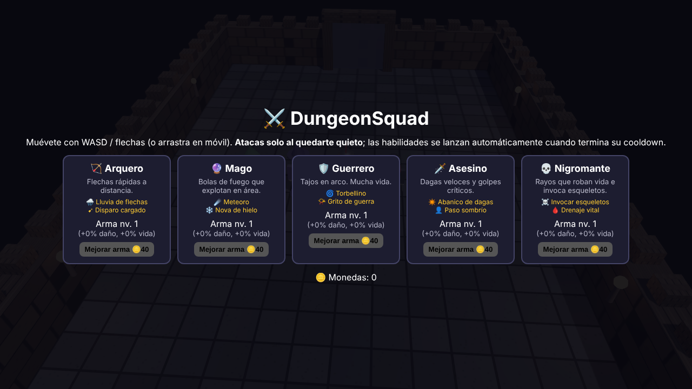
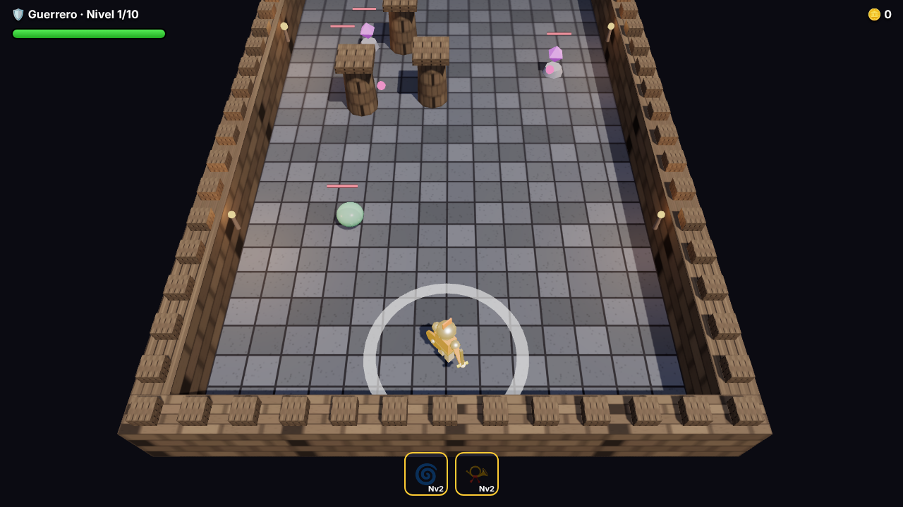
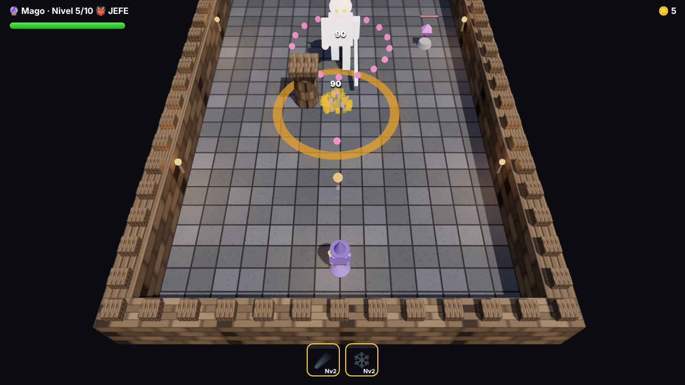

# ⚔️ DungeonSquad

Juego de acción 3D por niveles para el navegador. Elige un héroe, limpia salas llenas de monstruos y mejora sus armas y habilidades.



## 🎮 Cómo se juega

- **Moverse:** `WASD` o flechas del teclado. En móvil, arrastra el dedo por la pantalla.
- **Atacar:** tu héroe ataca solo al enemigo más cercano **cuando te quedas quieto**.
- **Habilidades:** se lanzan **automáticamente** cuando termina su cooldown. Lo ves en los iconos de la parte inferior.
- Elimina a todos los enemigos para abrir el **portal** y pasar al siguiente nivel.
- Hay **10 niveles**, con un **jefe** en los niveles 5 y 10.



## 🦸 Héroes

| Héroe | Estilo | Habilidad 1 | Habilidad 2 |
|---|---|---|---|
| 🏹 **Arquero** | Flechas rápidas a distancia | 🌧️ Lluvia de flechas | ➹ Disparo cargado |
| 🔮 **Mago** | Bolas de fuego con explosión en área | ☄️ Meteoro | ❄️ Nova de hielo |
| 🛡️ **Guerrero** | Tajos cuerpo a cuerpo, mucha vida | 🌀 Torbellino | 📯 Grito de guerra |
| 🗡️ **Asesino** | Dagas veloces y críticos | ✴️ Abanico de dagas | 👤 Paso sombrío |
| 💀 **Nigromante** | Rayos que roban vida | ☠️ Invocar esqueletos | 🩸 Drenaje vital |

## ⬆️ Progresión

- **Durante la partida:** al superar cada nivel eliges 1 de 3 cartas:
  - mejoras pasivas, como disparo múltiple, rebote, vampirismo o críticos;
  - desbloquear 🔓 o mejorar ⬆️ una habilidad: más daño y −15% de cooldown por nivel.
- **Entre partidas:** con las monedas ganadas mejoras el **arma** de cada héroe desde el menú (+20% de daño y +10% de vida por nivel). El progreso se guarda en tu navegador.



## 👹 Enemigos

- **Slime:** te persigue a saltos.
- **Cristal:** se queda quieto y dispara.
- **Orco:** lento, pero aguanta mucho y pega fuerte.
- **Demonio (jefe):** lanza anillos de proyectiles.

## 🚀 Ejecutar en local

No necesita instalación: es un único archivo HTML que usa [Three.js](https://threejs.org/) desde un CDN.

1. Descarga o clona el repositorio.
2. Abre `index.html` en el navegador.

Si tu navegador bloquea algo al abrirlo como archivo, sírvelo con un servidor local:

```bash
npx serve .
```

## 🌐 Publicar

- **GitHub Pages:** ve a *Settings → Pages → Branch `main` / root*.
- **Render:** crea un *Static Site*, deja el *Build Command* vacío y pon `.` como *Publish Directory*.

## 🛠️ Tecnologías

- HTML, CSS y JavaScript.
- Three.js r128 para el 3D.

## 📌 Ideas futuras

- [ ] Modelos 3D `.glb` animados
- [ ] Más héroes y mundos
- [ ] Sonido y música
- [ ] Árbol de talentos permanente
