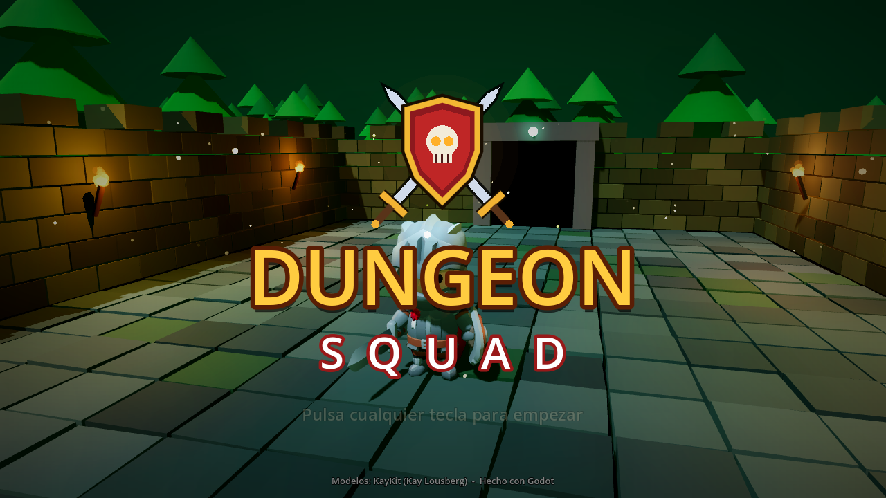
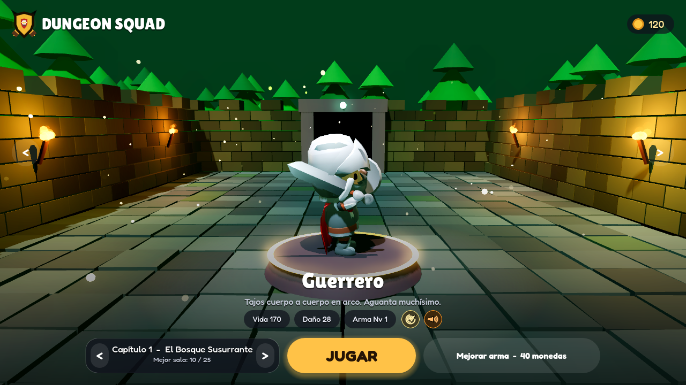
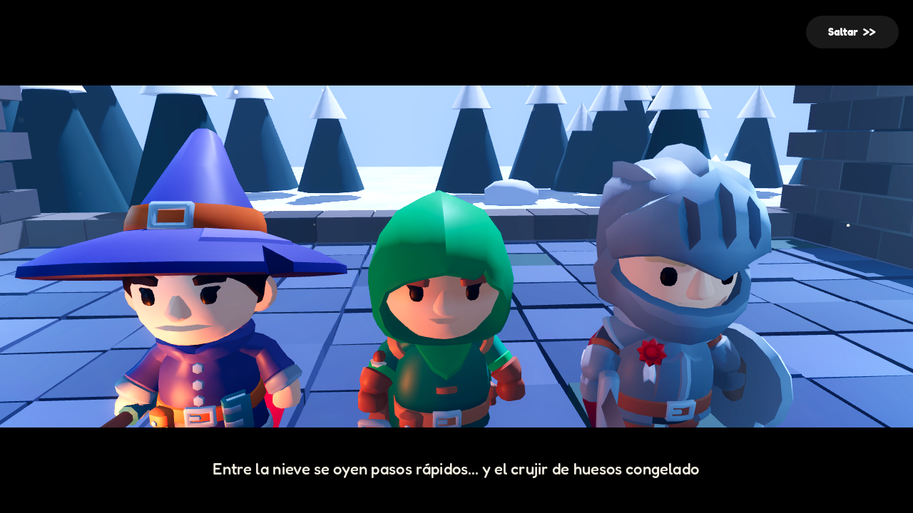
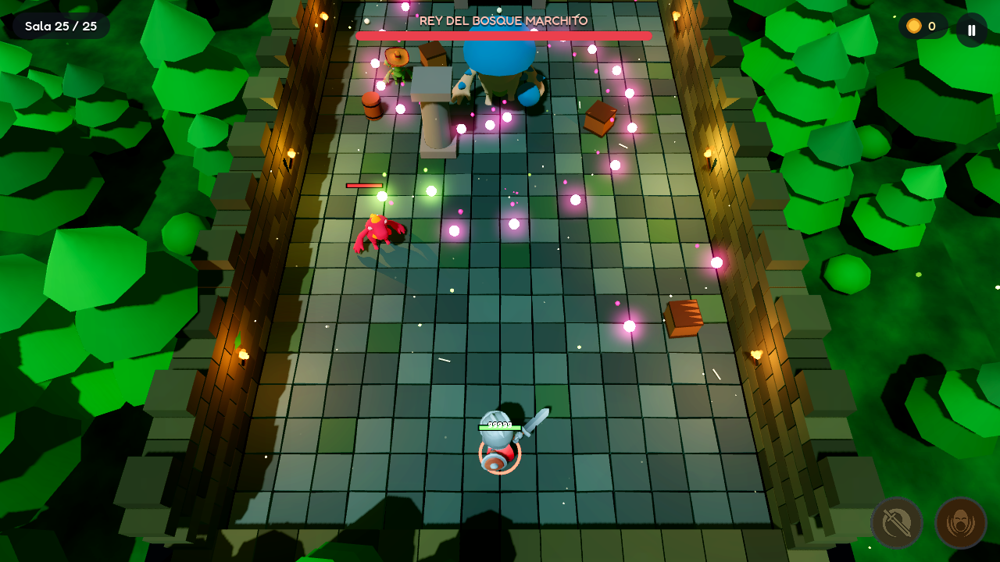
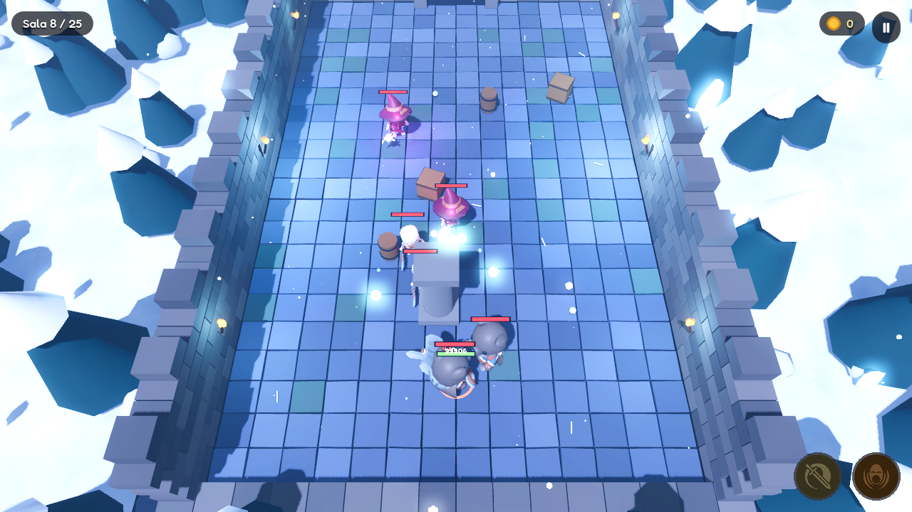
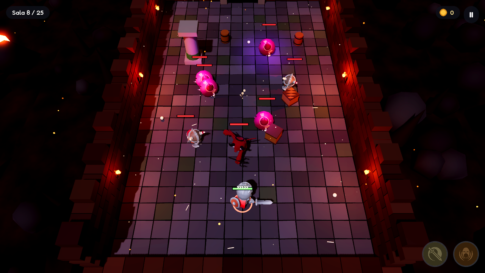
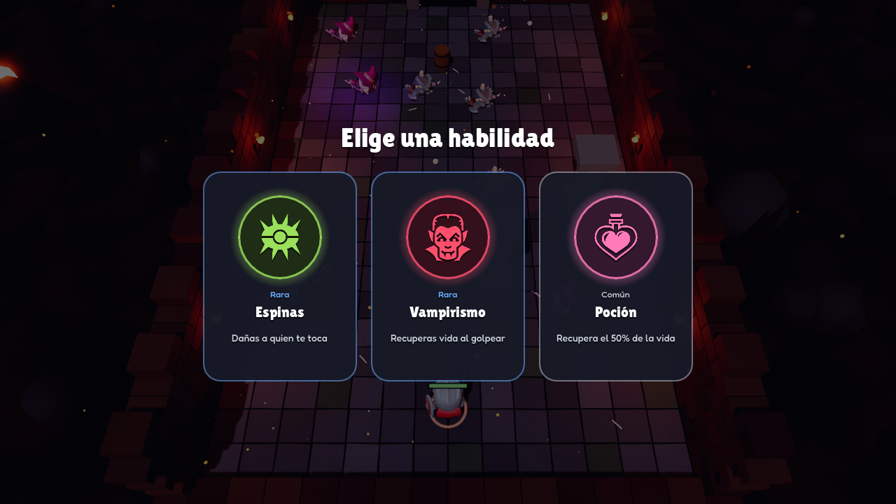
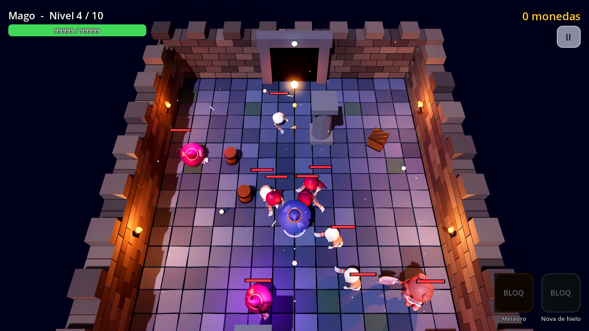
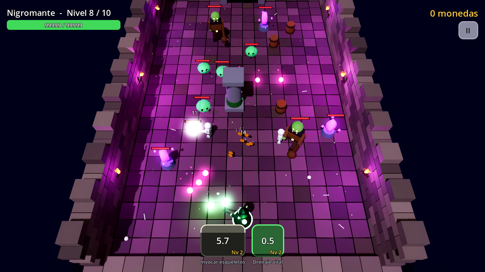

# ⚔️ DungeonSquad: versión Godot 4

Versión en **Godot 4** del juego, con personajes 3D animados (KayKit), iluminación dinámica, sombras, bloom, partículas, física, efectos de sonido y música.




## ▶️ Cómo abrirlo

1. Instala **Godot 4.3 o superior** (la versión estándar, no hace falta la de .NET): https://godotengine.org/download
2. Abre Godot, pulsa **Importar** y elige el archivo `godot/project.godot` de este repositorio.
3. Pulsa **▶ Ejecutar** (F5).

## 🎮 Controles

| Acción | Teclado | Mando | Móvil |
|---|---|---|---|
| Moverse | WASD / flechas | Stick izquierdo | Arrastra el dedo (joystick virtual) |
| Atacar | Quédate quieto | Quédate quieto | Suelta el dedo |
| Pausa | Esc / P | Start | Botón II |

Las **habilidades se lanzan solas** cuando termina su cooldown.

## 📖 Historia y capítulos

El nigromante **Malakar** ha despertado y su ejército de esqueletos invade el reino de Valdoria. Empiezas solo con **Sir Aldric, el Guerrero**, y vas rescatando al resto del escuadrón:

| Capítulo | Bioma | Jefe final | Héroes que desbloqueas |
|---|---|---|---|
| 1. El Bosque Susurrante | 🌲 Bosque | Rey del Bosque Marchito | Arquero (sala 10), Mago (sala 25) |
| 2. Las Cumbres Heladas | ❄️ Hielo y nieve | Rey Escarcha | Asesino (sala 10), Nigromante (sala 25) |
| 3. El Corazón del Volcán | 🌋 Lava | Malakar, Señor de las Cenizas | — |

- Cada capítulo tiene **25 salas**:
  - Campeón bárbaro en las salas 5 y 15.
  - Rey Esqueleto en las salas 10 y 20.
  - Jefe final en la sala 25.
- Al completar un capítulo se abre el siguiente.
- La historia se cuenta con **escenas animadas**: Malakar invoca a su ejército, el escuadrón llega al lugar, los héroes se rescatan de sus jaulas y todos lo celebran al final. Se pueden saltar.


- Fuera del mapa ves el paisaje de cada zona: árboles y luciérnagas, pinos nevados con nieve cayendo, o ríos de lava con chispas.





## ✨ Qué incluye

- **5 héroes animados** (correr, atacar, lanzar hechizos, morir…) con arma, ataque y 2 habilidades propias: Arquero, Mago, Guerrero, Asesino y Nigromante (un mago esqueleto).
- **Monstruos distintos en cada zona**, todos animados:

  | Zona | Monstruos | Campeón | Jefe final |
  |---|---|---|---|
  | 🌲 Bosque | Setas saltarinas, remolinos voladores, cactus que disparan espinas, dinosaurios que cargan | Dino Salvaje | Rey Champiñón |
  | ❄️ Hielo | Esqueletos, fantasmas, hechiceros esqueleto, bárbaros | Bárbaro de las Nieves | Demonio Azul (Rey Escarcha) |
  | 🌋 Volcán | Guerreros esqueleto con hacha, pícaros esqueleto, hechiceros, demonios | Demonio de Fuego | Malakar |

  El **Rey Esqueleto** aparece en las salas 10 y 20 de cada capítulo.
- **Flechas en el borde de la pantalla** que señalan a los enemigos que no se ven; la del jefe es dorada.
- **10 niveles** en 2 mundos (la mazmorra y el abismo), con jefe en los niveles 5 y 10.
- Las **salas se generan al azar**: columnas, cajas y barriles que bloquean el paso y los disparos.
- **Cartas de mejora** con rareza (común, rara, épica y legendaria), iconos dibujados y animaciones.
- **Pantalla de inicio** con el logo y textos de historia con efecto máquina de escribir.
- **Mejora permanente de armas** con las monedas. El progreso se guarda.
- **Sonido generado por código:** efectos para cada ataque, golpe, explosión, moneda y habilidad, más música ambiental tranquila y distinta en cada zona. La música y los efectos se pueden quitar por separado desde la pausa.
- **Efectos:**
  - números de daño (críticos en amarillo);
  - temblor de cámara y retroceso de los enemigos al golpearlos;
  - antorchas con luz que parpadea;
  - portal animado;
  - monedas que vuelan hacia ti.





## 🗂️ Estructura

```
godot/
├── project.godot
├── assets/kaykit/          # modelos 3D animados (CC0)
├── scenes/main.tscn        # escena principal
└── scripts/
    ├── game_data.gd        # datos de héroes/habilidades + guardado (autoload)
    ├── main.gd             # estados, niveles, cámara
    ├── player.gd           # héroe: movimiento, ataque y habilidades
    ├── enemy.gd            # IA de enemigos y jefe
    ├── projectile.gd       # proyectiles
    ├── minion.gd           # esqueletos invocados
    ├── coin.gd             # monedas
    ├── arena.gd            # generación de la mazmorra
    ├── audio.gd            # efectos de sonido y música (autoload Sfx)
    ├── char_model.gd       # carga y anima los modelos KayKit
    ├── biome.gd            # paisajes exteriores de cada capítulo
    ├── skill_icon.gd       # iconos vectoriales de habilidades
    ├── emblem.gd           # escudo del logo
    ├── builder.gd          # qué modelo y arma usa cada personaje
    ├── rig.gd              # esqueleto y animación procedural
    ├── fx.gd               # partículas y efectos
    └── ui.gd               # menús y HUD
```

**¿Quieres añadir un héroe?** Añádelo en `HEROES` dentro de `game_data.gd`, crea su modelo en `builder.gd` y sus habilidades en `player.gd` (función `cast`).

## 📦 Exportar (PC, Android, web o itch.io)

1. En Godot: **Editor → Gestionar plantillas de exportación → Descargar**.
2. Ve a **Proyecto → Exportar → Añadir…** y elige *Windows*, *Linux*, *Android* o *Web*.
3. Para la **web** o móviles flojos, cambia el renderizador a **Compatibility** (arriba a la derecha del editor). Algunos efectos como el SSAO se desactivan, pero el juego funciona igual.
4. Para **itch.io**, exporta a *Web*, comprime la carpeta en un `.zip` y súbela como juego HTML5.

## 🔜 Siguientes pasos

- [x] Personajes `.glb` animados (KayKit)
- [x] Música y efectos de sonido
- [ ] Más mundos y jefes
- [ ] Árbol de talentos permanente

## 🙏 Créditos

- Monstruos: **Ultimate Monsters**, de [Quaternius](https://quaternius.com), con licencia CC0.
- Iconos de habilidades: [game-icons.net](https://game-icons.net) (Lorc, Delapouite y otros), con licencia **CC BY 3.0**.
- Sonidos: **Kenney RPG Audio** y **Kenney Interface Sounds**, con licencia CC0.
- Fuentes: **Fredoka** y **Lilita One** (Google Fonts, SIL Open Font License).

- Modelos y animaciones: **KayKit Adventurers** y **KayKit Skeletons**, de [Kay Lousberg](https://www.kaylousberg.com), con licencia CC0. Las licencias están en `assets/kaykit/`.
